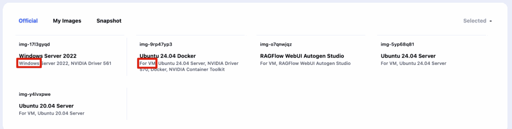
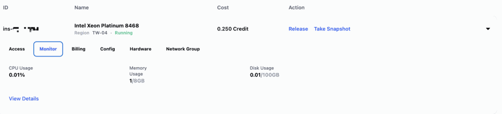
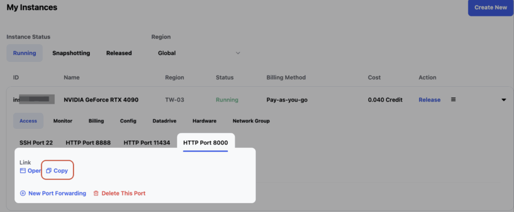
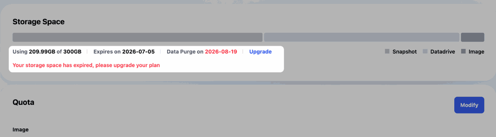
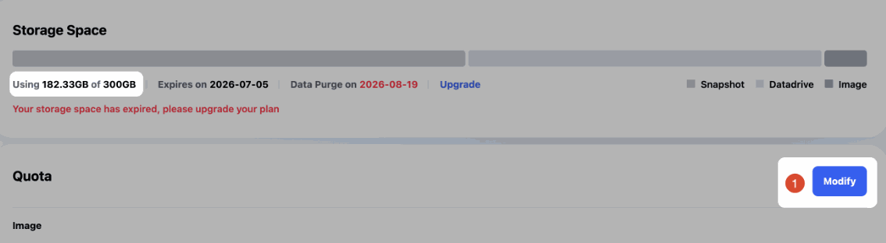
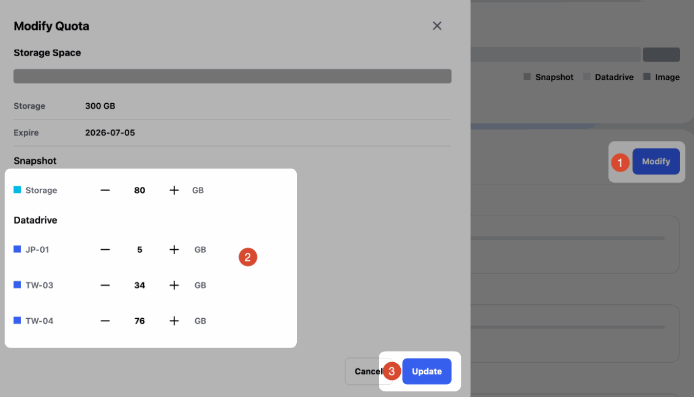
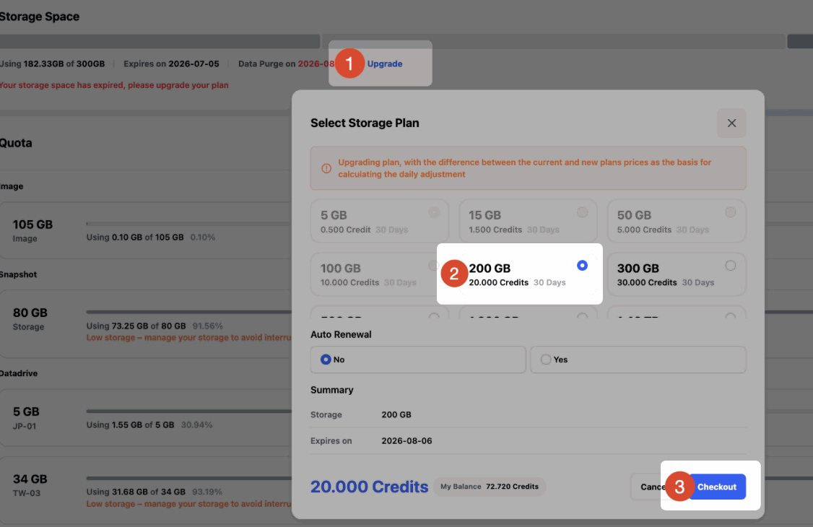

# Glows.ai GPU Rental Platform FAQs

This page collects frequently asked questions about the Glows.ai GPU rental platform, covering data storage, instance environments, connection methods, auto deployment, billing, and service guarantees. If you need further assistance, feel free to contact us through our official support channels.

## Instance Types and Permissions

### Does the platform support Docker or K8s? What is the difference between VM and Container?

Glows.ai provides two underlying cloud service types: VM and Container.

- Container instances come with more pre-configured base environments and are easier to set up, but they do not support running Docker inside the instance, nor modifying low-level software such as NVIDIA drivers.
- VM instances have higher privileges and support custom GPU drivers, Docker, Systemctl, and more. They are suitable for workloads that require full system control.

When creating an instance, selecting an Image labeled `Windows` or `For VM` gives you a VM instance.



### After logging in to a VM instance, I am not root and get permission errors when running commands such as docker. What should I do?

VM instances log in as the glows user by default. When you need root privileges, run:

```bash
sudo su
```

to switch to root. The password is the SSH password of the glows user shown under `Access` on the instance page.

If you only want to run a single command, you can also prefix it with sudo, for example `sudo docker ps`.

### Do I have root privileges?

Yes. Instances log in with the root account by default. You can also create other users after logging in.

### Can I choose my own OS environment?

The platform currently provides Ubuntu-series OS environments and Windows Server 2022. Ubuntu is recommended for general use. If you need another OS, please contact us for evaluation.

### Can the Windows environment experience lag or instability during remote operation?

When operated through remote desktop, Windows may lag due to network conditions, the graphical interface, and workload. If your task does not depend on Windows, we recommend using a Linux environment for a more stable training and inference experience.

### Can I update the NVIDIA Driver myself?

It depends on the instance type:

- Container instances do not currently support changing the NVIDIA Driver.
- On VM instances, you can download and update the Driver yourself. If needed, the platform can provide technical support and the official NVIDIA download link.

### Can I view GPU/CPU usage, memory, and disk information in real time?

Yes. After an instance is created, the instance page provides a `Monitor` feature where you can view trends for CPU/GPU utilization, GPU memory, system memory, disk space, and other metrics.



## Connections and Ports

### Which remote connection methods are supported?

Ubuntu instances support SSH and JupyterLab; Windows instances support RDP. We recommend using the connection methods provided by the platform. If you need other connection tools, you can install the related services yourself after logging in to the instance.

### Does `tw-02.access.glows.ai` in the RDP connection URL indicate the instance's region?

Not necessarily. The `tw-02` in the connection URL may be an access node code and does not indicate the region of the actual compute host. Please refer to the deployment region shown on the instance page.

### Why does SSH disconnect after being idle for a while, showing "closed by remote host" or "Broken pipe"? How can I prevent it?

This is usually caused by network fluctuations or a long period of inactivity. The instance itself keeps running normally.

Add keepalive settings when connecting so that your computer periodically sends signals to the server, and the connection will not be dropped for being idle too long:

```bash
ssh -o ServerAliveInterval=30 -o ServerAliveCountMax=6 -p <port> glows@<host>
```

A signal is sent every 30 seconds, and the connection is considered lost only after 6 consecutive missed responses (about 3 minutes).

### My service is running inside the instance. How do I access it from outside? (e.g., port 8000)

1. Set the service host to `0.0.0.0`. If it is set to `localhost` or `127.0.0.1`, only the machine itself can reach it.
2. On the instance page, click `New Port Forwarding`, enter the service port (e.g., 8000), and check HTTPS. A public URL will be generated.

Note: The port in the URL will not be 8000, but something like `:23456` (as shown below, the URL you get after clicking `Copy` will not use 8000). The platform maps the port inside the machine to another unused port to avoid conflicts when everyone uses 8000.



### How can my instance have a publicly exposed port as soon as it starts?

When creating an instance with the SDK, include the port you want to open in `ports`, for example:

```json
"ports": "[{\"port\":8000,\"protocol\":2}]"
```

Once the instance is Running, this port will also appear in the `Access` tab on the platform, and the `accesses` field returned by the instance query API will contain the corresponding URL (for example: `https://tw-07.access.glows.ai:23456?token=xxxxxxx`).

Note: The service inside the machine still uses 8000, but the port in the public URL is assigned by the platform, for example `:23456`.

### How can I give my service a fixed URL?

You can use Bind IP and start the machine through the SDK API: include `public_ip_id` when creating the instance, and set `exposePort` in `ports` to specify the public port.

For example:

```json
"public_ip_id": "net-xxxxxxxx",
"region_name": "TW-03",
"ports": "[{\"port\":8000,\"protocol\":2,\"exposePort\":18080}]"
```

The address will be "Bind IP:exposePort", for example `11.11.11.11:18080`. After the instance is released, recreating it with the same settings keeps the address unchanged.

Note:

- If you release the Public IP and create it again, the URL will be reassigned, so keep the Public IP active while you are using it.
- The same `exposePort` on the same IP can only be used by one instance.

### Will the IP/DNS change after an instance is shut down or restarted?

It may. If you need a more stable service entry point, we recommend using the fixed service link provided by Auto Deploy and designing your own traffic distribution strategy.

## DataDrive

### Will data on the instance disk disappear after the instance is released or the rental period ends?

Yes. The instance disk is only valid while the instance is running and is cleared after release.

We recommend storing important data on DataDrive. If you need to keep your environment or installed software, create a Snapshot before releasing the instance. If you don't use platform storage, you can also download data to your local machine with tools such as `scp` before releasing.

### Can I stop compute charges by shutting down an instance and keep only storage charges?

Yes. When you don't need to run training or inference tasks for a while, you can release the instance to stop GPU compute billing, and keep the data or environment you need through DataDrive and Snapshot.

- Data files such as models, datasets, and code are best stored on DataDrive. DataDrive supports uploading and downloading data without starting an instance.
- For content you want to reuse next time, such as Python packages, system software, and environment settings, we recommend clicking `Take Snapshot` before releasing the instance to create an environment snapshot.
- A Snapshot saves changes inside the instance other than DataDrive. The smaller the Snapshot, the faster it usually is to create a new instance from it.

DataDrive and Snapshot require purchasing a storage plan on the Storage Space page. You can allocate DataDrive and Snapshot capacity based on your actual needs.

### Where can I see the files I uploaded to DataDrive?

Choose to mount DataDrive when creating the instance. After logging in to the instance, you can view the files in the `/datadrive` directory.

```bash
ls /datadrive
```

### When creating an instance with the SDK, how do I specify that DataDrive should be mounted?

You don't need to specify it. Instances created with the SDK mount DataDrive by default, and it is available at `/datadrive` after boot.

### Why do I need to reconfigure permissions to read DataDrive after mounting it?

Usually you don't need to configure permissions, because the default glows user already has read and write access to DataDrive and can read it directly.

Additional setup is usually only required when you have created other users, or when a tool runs as another user, for example when linking a DataDrive folder into the VM for an internal tool to read.

In this case, you can set up the users, permissions, and links, then take a Snapshot. Booting from this snapshot afterwards means you won't need to reconfigure them each time.

### Can multiple instances share the same DataDrive?

Yes. Instances in the same region can share data by mounting DataDrive. Before running production tasks, we recommend creating a test instance to confirm that the image environment, paths, and permissions fit your workflow.

### Can I add or mount DataDrive on a VM that is already running?

Adding a DataDrive mount to a running instance is not currently supported. Please select the DataDrive you need when creating the instance.

### After rebooting an instance with DataDrive mounted, the `/datadrive` directory disappeared. Is my data lost?

No. DataDrive data is not lost when the instance reboots. If it is not mounted automatically after a reboot, run the following command inside the instance to mount it manually:

```bash
sudo mount -t virtiofs DataDrive /datadrive
```

This usually happens when automatic mounting is not triggered during the reboot. The platform will continue to improve this process.

### Can I upload or download data without starting an instance?

Yes. DataDrive supports offline upload and download without starting a GPU instance first.

- DataDrive tutorial video: [https://www.youtube.com/watch?v=_MtYfNKQ3xA](https://www.youtube.com/watch?v=_MtYfNKQ3xA)
- DataDrive PC app: [https://glows.ai/datadrive](https://glows.ai/datadrive)

### Can the DataDrive web version upload an entire folder at once?

The DataDrive web version currently mainly supports single-file uploads. To upload an entire folder, we recommend compressing it into a single file first, or using the DataDrive PC app instead.

DataDrive PC app download link: [https://glows.ai/datadrive](https://glows.ai/datadrive)

### What should I do if uploading a large file through the DataDrive web version fails?

We recommend using the DataDrive PC app instead. The PC app supports Windows and macOS and is suitable for uploading or downloading large files and folders.

Download link: [https://glows.ai/datadrive](https://glows.ai/datadrive)

### Can I transfer data to DataDrive using commands?

Yes. If you need to operate via API or commands, refer to the [Glows DataDrive Operation Guide](https://hackmd.io/@HulblT-3TB2jIrg2ZPZpyA/glows-dd-api). This method is better suited to customers with development experience; for general use, we recommend the DataDrive web version or PC app.

### How do I transfer local models and Python code to a Glows.ai instance?

We recommend using DataDrive first:

1. Upload local files to DataDrive.
2. Mount DataDrive when creating the instance.
3. After logging in to the instance, read the files from the `/datadrive` directory.

If the instance is already running, you can also transfer files with `scp`. The following example transfers files from a local Windows machine to `/home` on the instance:

```bash
scp -P 23675 -r C:\Users\Data root@tw-03.access.glows.ai:/home
```

The SSH address and port may differ for each instance. Please refer to the information shown on the instance page.

### Can DataDrives in different regions be synced directly?

Direct cross-region DataDrive syncing is not currently supported. To move data from TW-01 to TW-02, download it to your local machine first, then upload it to the DataDrive in the target region.

### What causes `Disk quota exceeded` when writing to DataDrive?

This error usually means there is not enough storage space. Common causes include:

- DataDrive capacity is used up. Clean up unneeded files, or expand capacity on the Storage page.
- The Storage plan has expired and must be renewed before you can continue using it.

### I deleted all files on DataDrive. Why is some capacity still used (e.g., 186 bytes), and why can't I lower the Storage quota?

Usually hidden files are still taking up space. For example, when deleting files in Linux, they may first be moved to a hidden trash folder (such as `/datadrive/.Trash-0`), which a regular `ls` does not show.

1. Start an instance with this DataDrive mounted (the cheapest CPU machine is fine) and run `ls -alh /datadrive` to view hidden files
2. After confirming the files are no longer needed, delete them, for example `rm -rf /datadrive/.Trash-0`
3. Go back to Storage Space and adjust the quota again

### DataDrive is empty, so why does the Storage page still show used capacity?

After deleting data through the DataDrive interface, the Storage page usually takes 5-10 minutes to sync. To confirm the actual usage, create an instance in the same region with DataDrive mounted, then run:

```bash
# Check total storage usage
df -h

# List files and folders under /datadrive
ls -alh /datadrive
```

The Ubuntu file system may temporarily move some deleted files to `/datadrive/.Trash-0`. If you are sure they are no longer needed, run the following command to permanently delete them:

```bash
# This operation cannot be undone. Double-check the path before running it.
rm -rf /datadrive/.Trash-0
```

## Snapshot

### Does the Glows.ai snapshot feature keep installed programs and data?

Yes. A Snapshot saves the files, settings, installed software, and configuration inside the instance at the time the snapshot is taken, but it does not include data on DataDrive.

### How can I use Snapshots more efficiently?

A Snapshot saves changes on the instance disk. We recommend keeping environments, packages, and system settings on the instance disk, and placing datasets, model weights, and code on DataDrive. This reduces Snapshot size and speeds up creating new instances from the snapshot later.

When using a Snapshot across regions, the speed of creating a new instance depends on the Snapshot size and network transfer conditions, so we recommend keeping Snapshots lean.

### Can Snapshots be exported?

No. Snapshots use a snapshot format internal to the Glows.ai platform and cannot currently be exported directly.

### After booting from a snapshot, are my previous Port Forwarding settings still there? Will the URL change?

No, and the URL will change as well.

Port Forwarding is a public channel assigned by the platform (a channel from the outside into the machine). It is configured on the platform, not inside the machine, so you need to click `New Port Forwarding` again every time you boot from a snapshot. The services inside the machine (whether they are running and which port they listen on) are stored on the disk and are saved by the snapshot.

### My saved snapshot had VNC, but VNC is gone after starting it again. (I can't see the VNC port link after creating an instance from the snapshot)

First check whether the VNC service is running, then check whether the corresponding port is opened on the platform.

1. After logging in via SSH, check whether the VNC service started properly. Run `ss -napt | grep 5901` or `ps aux | grep vnc` to check port listening and processes.
2. If the VNC service is working, click `New Port Forwarding` on the platform and set the port for the VNC service (the port VNC listens on inside the machine, commonly 5901).
3. If VNC is not running, start the VNC service first. If the image does not come with VNC pre-installed (e.g., the Ubuntu image), you need to install it yourself.

### After booting from a snapshot, my service didn't start automatically. How do I set it to start on boot?

It depends on the instance type:

- **Container**: Add the service startup command to `/usr/bin/glows_init.sh`
- **VM**: Use systemd to start the service on boot. See the tutorial (using auto-starting a Docker container as an example): [How to Automatically Restart a Docker Container on Boot on Glows.ai](https://glows.ai/article/ubuntu_docker_restart_boot)

## Storage Plans

### Are DataDrive and Snapshots automatically deleted after the storage plan expires?

They are not deleted immediately. DataDrive and Snapshots are managed under storage plans. After a plan expires, the data is kept in a recoverable state for a period of time, but you must renew before you can continue using it normally. To avoid affecting your tasks, we recommend renewing before the plan expires.

### How do I downgrade my plan when renewing Storage?

To downgrade from a higher-capacity plan to a lower-capacity plan, you must first make sure your current actual usage is below the capacity of the target plan.

For example, if your current plan is 300GB and you want to renew at 200GB, you must first reduce your actual usage to below 200GB. You can delete files you no longer need from DataDrive, Snapshot, or Images.



After cleaning up, confirm that usage is below the target plan capacity.



Click `Modify`, adjust the total allocated quota to be less than or equal to the target plan capacity, then click `Update`.



When finished, click `Upgrade` to select the lower-capacity plan.



### If I change the Storage Space plan size, do running instances need to remount DataDrive to apply the new size?

No remount is needed. Data is synced in real time, and you can expand capacity at any time.

### How is storage space priced?

Storage space is billed by plan or by usage. Please refer to the platform's Storage page for specific prices. For bulk purchases or enterprise needs, please contact us.

## Custom Images

### How do I upload a custom Docker image?

Please refer to the official tutorial: [Upload Custom Docker Image](/docs/upload-custom-docker-image)

### My Image file is large, and the upload was interrupted by an unstable network or switching pages. What should I do?

The platform supports resumable uploads. Even if the upload is interrupted, you can continue from where it stopped without starting over.

### What does the `.partial` file suffix mean?

`.partial` is a temporary file generated by the system while a file is uploading. It disappears automatically after the upload completes and does not affect normal use.

## Auto Deploy and API Automation

### Is auto scaling supported?

Yes. The platform provides Auto Deploy, which automatically creates an instance and starts the service when a request is received, and releases the instance after it becomes idle.

The typical flow is:

1. The client requests the Auto Deploy link.
2. The Glows.ai backend creates an instance based on your configuration.
3. The Service Start Command you configured is executed.
4. The request is forwarded to the service port you configured.
5. The result is returned.
6. If no new requests arrive within the idle time you configured (Instance Idle Retention Period), the platform automatically releases the instance.

If you have concurrency requirements, we recommend using your own traffic distribution strategy together with multiple Auto Deploy configurations.

### Is CLI or API-based auto deployment available?

- **API**: Yes. Glows.ai provides an SDK HTTP API that lets you create, query, and release instances programmatically, as well as configure ports, networking, and Snapshots. You can create an SDK Token yourself: open [https://platform.glows.ai/profile](https://platform.glows.ai/profile) → `Platform Setting` → `SDK Token` → `New Token`. API documentation: [https://sdkdoc.glows.ai](https://sdkdoc.glows.ai)
- **Auto Deploy**: Currently configured through the web interface; the SDK API does not include Auto Deploy features. If you need to control instance start/stop programmatically, use the SDK API to operate instances directly.

### Can I start and stop machines via API to avoid idle charges?

Yes. Create an instance with the SDK API (`POST /instance`) and release it when not in use (`DELETE /instance`).

## Network and Enterprise Plans

### Does the platform sell network traffic? Is fixed bandwidth or a fixed IP available?

In general, the platform does not charge separately for data transfer. A fixed IP (Bind IP) can be purchased directly on the platform. If you need advanced networking capabilities such as fixed 1Gbps bandwidth, you can apply for an add-on, which will be enabled after our sales and technical teams confirm your requirements.

### Can access be restricted to an enterprise private network or VPN?

Yes. The platform provides an IP ACL feature that lets you set which IPs are allowed to access an instance, for example allowing connections only from your company's VPN network.

### Can existing servers or GPU machines be integrated into Glows.ai?

This can be evaluated as a hybrid cloud or private cloud project, integrating local CPU/GPU machines into part of the compute resource pool. Feasibility must be confirmed by our technical team based on your hardware, network, and deployment requirements.

If you are interested, please [contact us](#contact-us).

### Does the private cloud support adding CPU machines for unified management?

Yes. The private cloud solution can integrate local non-GPU machines as needed and provide unified management and scheduling. The specific solution requires project evaluation.

## GPU Resources

### Do H100/H200 GPUs support NVIDIA MIG partitioning?

The H100/H200 GPUs deployed on the Glows.ai platform support NVIDIA MIG. The specific availability and configuration depend on the product plan and actual resource conditions.

### Are GPUs only rented as whole cards?

The platform currently mainly offers whole-GPU rentals.

### Is NCCL communication between GPUs supported?

Yes. NCCL can be used for distributed training and multi-GPU data synchronization.

### Are there plans to launch vGPU?

There is no official launch date for vGPU yet. If you have needs related to partial GPU memory, cost control, or virtualized GPUs, please summarize your use case and send it to us for evaluation.

## Applications (ComfyUI, FramePack)

### Videos generated with tools such as FramePack can't be downloaded. What should I do?

First make sure the instance has not been released, then try downloading manually through JupyterLab:

1. Open JupyterLab for the instance.
2. Go to `/FramePack/outputs/`.
3. Find the generated `.mp4` file.
4. Right-click the file and select `Download`.

If you still can't download it, please take a screenshot and contact platform technical support.

### Custom nodes are missing after importing a workflow into ComfyUI. How do I fix this?

First create an instance and load the workflow, then provide the error screen or the missing-node message. Platform technical support can help identify the custom nodes or dependencies that need to be installed.

### What does it mean when ComfyUI reports a missing Model while testing WAN 2.1?

It usually means the model has not been loaded correctly. Please check that the model file location, workflow settings, and model name are correct. If the issue persists, please provide a screenshot of the error for technical support to analyze.

## Account, Billing, and Top-Up

### Can I register with a regular email instead of Gmail?

The system currently supports registration with Gmail and GitHub by default. If you need to create an account with a regular email, please contact our technical or sales team for assistance.

### Is there a minimum amount for online top-up?

Yes. The minimum online top-up amount is USD 10, in increments of USD 10.

### What happens if I forget to top up and run out of credits?

When your credits run out, the system automatically creates a snapshot of running instances and shuts them down. After topping up again, you can restore your environment from the automatically generated snapshot.

### Is there a minimum rental duration?

No. The platform uses a pay-as-you-go billing model, so you only pay for what you use. No GPU compute charges are incurred when an instance is not running; only storage fees are charged based on actual usage.

### What is the price of H100 GPUs?

Please refer to the platform page for H100 GPU pay-as-you-go pricing. For long-term rentals or monthly plans, please contact us for discounted pricing.

### Are there discounts for bulk or long-term rentals?

Yes. For bulk or long-term rentals, please contact us through:

- **Email:** [support@glows.ai](mailto:support@glows.ai)
- **Discord:** [https://discord.com/invite/glowsai](https://discord.com/invite/glowsai)
- **Line:** [https://lin.ee/fHcoDgG](https://lin.ee/fHcoDgG)

### Do I need to pay a subscription fee, setup fee, or minimum usage fee before using the platform?

No. In general use, there are no subscription fees, setup fees, or minimum usage fees.

### How is pricing determined for software or platform partners?

Billing plans can be evaluated based on usage, storage, and the partnership model. For reselling, distribution, or platform partnerships, please contact our sales team to discuss a partnership agreement.

## Service Guarantees and Compensation

### Do you provide an SLA?

Yes. The platform currently provides service level commitments mainly for hardware and storage services:

- Core hardware services: 99% availability.
- DataDrive storage service: 99.9% availability.

Specific terms are subject to the official service agreement.

### Is there a backup and compensation policy if the service is interrupted?

If a rented instance becomes unavailable due to hardware or platform issues, we will promptly investigate the outage time and cause, prioritize restoring service and data, and provide compensation as appropriate.

Basic compensation reference:

- Outage of 1-3 hours: 6 hours of compensation.
- Outage of 6-12 hours: 12 hours of compensation.

If an outage causes major impact such as data loss or unrecoverable task interruption, the platform will further evaluate the specific situation. Except in special cases such as physical disk failure, stored data is normally not lost. We recommend storing important data on DataDrive first.

## Contact Us

If you have any questions or suggestions while using Glows.ai, please contact us by email, Discord, or Line.

**Email:** [support@glows.ai](mailto:support@glows.ai)

**Discord:** [https://discord.com/invite/glowsai](https://discord.com/invite/glowsai)

**Line:** [https://lin.ee/fHcoDgG](https://lin.ee/fHcoDgG)
