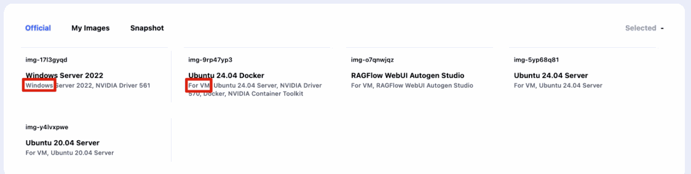
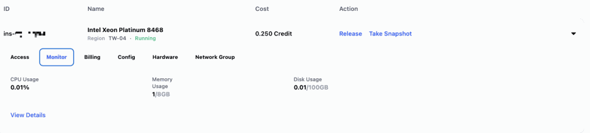
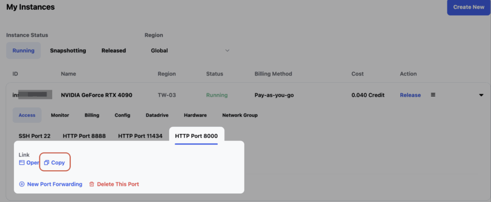
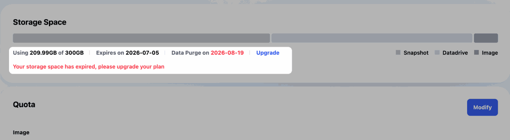
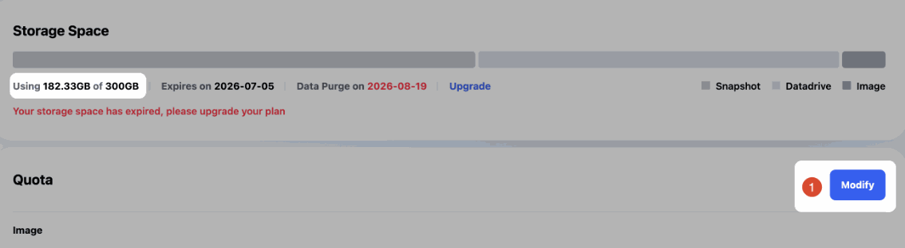
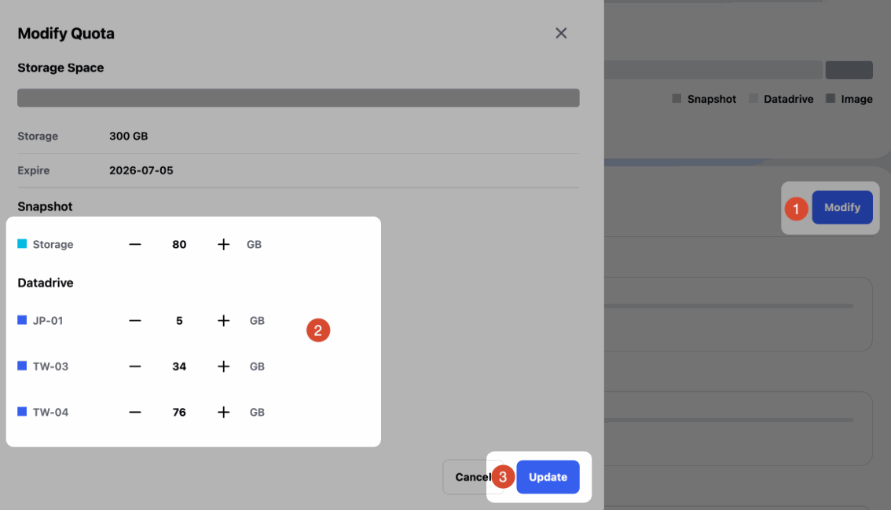
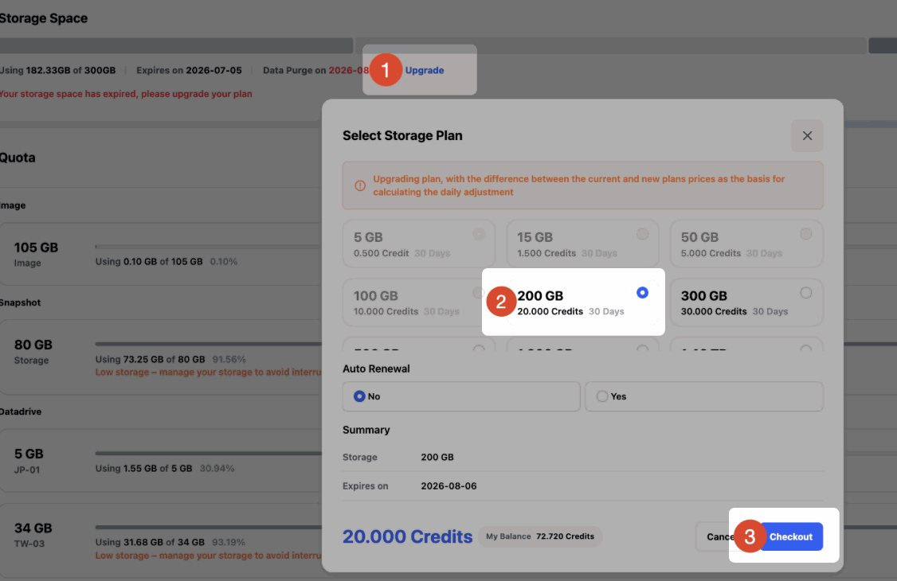

# Glows.ai GPU レンタルプラットフォーム よくある質問

本ページでは、Glows.ai GPU レンタルプラットフォームに関するよくある質問をまとめています。データストレージ、インスタンス環境、接続方法、自動デプロイ、課金、サービス保証などの内容を扱っています。さらにサポートが必要な場合は、公式サポート窓口からお気軽にお問い合わせください。

## インスタンスの種類と権限

### Docker や K8s は使えますか？VM と Container の違いは何ですか？

Glows.ai では、VM と Container の 2 種類のクラウドサービス形態を提供しています。

- Container インスタンスは、あらかじめ設定済みのベース環境が多く用意されており、環境構築が簡単です。ただし、インスタンス内で Docker を使用することや、NVIDIA ドライバーなどの低レイヤーのソフトウェアを変更することはできません。
- VM インスタンスはより高い権限を持ち、GPU ドライバーのカスタマイズ、Docker、Systemctl などに対応しています。システム全体を制御する必要があるワークロードに適しています。

インスタンス作成時に `Windows` または `For VM` と表示された Image を選択すると、VM インスタンスになります。



### VM インスタンスにログインすると root ではなく、docker などのコマンドを実行すると権限が不足します。

VM インスタンスには、デフォルトで glows ユーザーとしてログインします。root 権限が必要な場合は、次のコマンドを実行してください：

```bash
sudo su
```

これで root に切り替わります。パスワードは、インスタンスページの `Access` に表示されている glows ユーザーの SSH パスワードです。

単一のコマンドだけを実行したい場合は、先頭に `sudo` を付けることもできます（例：`sudo docker ps`）。

### root 権限はありますか？

あります。インスタンスにはデフォルトで root アカウントでログインします。ログイン後に他のユーザーを作成することもできます。

### OS 環境を選べますか？

現在、プラットフォームでは Ubuntu 系の OS 環境と Windows Server 2022 を提供しています。一般的な用途では Ubuntu をおすすめします。その他の OS が必要な場合は、お問い合わせいただければ検討いたします。

### Windows 環境ではリモート操作が重くなったり不安定になったりしますか？

Windows をリモートデスクトップで操作する場合、ネットワーク、グラフィカルインターフェース、ワークロードの影響で動作が重くなることがあります。Windows が必須でないタスクであれば、より安定したトレーニング・推論のために Linux 環境の利用をおすすめします。

### NVIDIA Driver を自分で更新できますか？

インスタンスの種類によって異なります：

- Container タイプのインスタンスでは、NVIDIA Driver を自分で変更することは現在できません。
- VM タイプのインスタンスでは、ご自身で Driver をダウンロードして更新できます。必要に応じて、プラットフォームから技術サポートや NVIDIA 公式のダウンロードリンクを提供いたします。

### GPU/CPU 使用率、メモリ、ディスクなどの情報をリアルタイムで確認できますか？

できます。インスタンス作成後、インスタンスページの `Monitor` 機能で、CPU/GPU 使用率、GPU メモリ、システムメモリ、ディスク容量などの推移を確認できます。



## 接続とポート

### どのようなリモート接続方法に対応していますか？

Ubuntu インスタンスは SSH と JupyterLab、Windows インスタンスは RDP に対応しています。プラットフォームが提供する接続方法の利用をおすすめします。その他の接続ツールが必要な場合は、インスタンスにログインした後、関連サービスをご自身でインストールしてください。

### RDP 接続 URL の `tw-02.access.glows.ai` は、インスタンスのリージョンを表していますか？

必ずしもそうではありません。接続 URL の `tw-02` はアクセスノードのコードである場合があり、実際の計算ホストのリージョンを表すものではありません。インスタンスページに表示されるデプロイリージョンをご確認ください。

### SSH がしばらく操作しないと切断され、「closed by remote host」や「Broken pipe」と表示されます。どうすれば防げますか？

通常、ネットワークの揺らぎや長時間の無操作が原因です。インスタンス自体は通常どおり稼働しています。

接続時に keepalive の設定を追加すると、PC から定期的にサーバーへ信号が送られ、長時間操作しなくても接続が切れにくくなります：

```bash
ssh -o ServerAliveInterval=30 -o ServerAliveCountMax=6 -p <port> glows@<host>
```

30 秒ごとに信号を送り、6 回連続（約 3 分）応答がない場合にのみ切断と判定します。

### インスタンス内でサービスを起動しました。外部からどのように接続しますか？（例：8000 番ポート）

1. サービスの host を `0.0.0.0` に設定してください。`localhost` や `127.0.0.1` に設定すると、マシン自身からしか接続できません。
2. インスタンスページで `New Port Forwarding` をクリックし、サービスのポート（例：8000）を入力して HTTPS にチェックを入れると、外部公開用の URL が生成されます。

補足：URL に含まれるポートは 8000 ではなく、`:23456` のような番号になります（下図のとおり、`Copy` をクリックして取得した URL は 8000 になりません）。プラットフォームがマシン内のポートを別の未使用ポートに対応付けることで、全員が 8000 を使っても衝突しないようにしています。



### インスタンス起動時から外部公開ポートを開いておくにはどうすればよいですか？

SDK でインスタンスを作成する際、`ports` に開きたいポートを指定します。例：

```json
"ports": "[{\"port\":8000,\"protocol\":2}]"
```

インスタンスが Running になると、プラットフォームの `Access` タブにもこのポートが表示され、インスタンス取得 API のレスポンスの `accesses` にも対応する URL が含まれます（例：`https://tw-07.access.glows.ai:23456?token=xxxxxxx`）。

注意：マシン内のサービスは 8000 のままですが、外部公開 URL のポートはプラットフォームが割り当てます（例：`:23456`）。

### サービスの URL を固定するにはどうすればよいですか？

Bind IP を使用し、SDK API でマシンを起動します。インスタンス作成時に `public_ip_id` を指定し、`ports` で `exposePort` を設定して外部公開ポートを指定してください。

例：

```json
"public_ip_id": "net-xxxxxxxx",
"region_name": "TW-03",
"ports": "[{\"port\":8000,\"protocol\":2,\"exposePort\":18080}]"
```

アドレスは「Bind IP:exposePort」となり、例えば `11.11.11.11:18080` のようになります。インスタンスを解放した後も、同じ設定で再作成すればアドレスは変わりません。

注意：

- Public IP を解放してから再作成すると、URL は再割り当てされます。利用中は Public IP を維持してください。
- 同じ IP の同じ `exposePort` は、1 台のインスタンスでしか使用できません。

### インスタンスをシャットダウンまたは再起動すると、IP/DNS は変わりますか？

変わる可能性があります。より安定したサービスの入口が必要な場合は、Auto Deploy の固定サービスリンクを利用し、トラフィック分散の仕組みはご自身で設計することをおすすめします。

## DataDrive

### インスタンスを解放した後やレンタル期間が終了した後、インスタンスのディスク上のデータは消えますか？

消えます。インスタンスのディスクはインスタンスの稼働中のみ有効で、解放後にデータは削除されます。

重要なデータは DataDrive に保存することをおすすめします。環境やインストール済みのソフトウェアを残したい場合は、インスタンスを解放する前に Snapshot を作成してください。プラットフォームのストレージを使わない場合は、解放前に `scp` などでローカルにダウンロードすることもできます。

### インスタンスを停止して計算費用を止め、ストレージ費用だけにすることはできますか？

できます。トレーニングや推論のタスクをしばらく実行しない場合は、インスタンス（Instance）を解放して GPU の計算費用を止め、必要なデータや環境は DataDrive と Snapshot で保持できます。

- モデル、データセット、コードなどのデータファイルは、DataDrive に保存することをおすすめします。DataDrive は、インスタンスを起動せずにデータのアップロード・ダウンロードができます。
- Python パッケージ、システムソフトウェア、環境設定など次回も使いたい内容は、インスタンスを解放する前に `Take Snapshot` をクリックして環境の Snapshot を作成することをおすすめします。
- Snapshot には、DataDrive 以外のインスタンス内部の変更が保存されます。Snapshot が小さいほど、Snapshot から新しいインスタンスを作成する速度は通常速くなります。

DataDrive と Snapshot を利用するには、Storage Space ページでストレージプランを購入する必要があります。DataDrive と Snapshot の容量は、実際の必要に応じて割り当てられます。

### DataDrive にアップロードしたファイルはどこで確認できますか？

インスタンス作成時に DataDrive のマウントを選択してください。インスタンスにログインすると、`/datadrive` ディレクトリでファイルを確認できます。

```bash
ls /datadrive
```

### SDK でインスタンスを作成する場合、DataDrive のマウントはどう指定しますか？

指定は不要です。SDK で作成したインスタンスにはデフォルトで DataDrive がマウントされ、起動後に `/datadrive` で利用できます。

### DataDrive をマウントした後、読み取るために権限を設定し直す必要があるのはなぜですか？

通常、権限の設定は不要です。デフォルトの glows ユーザーは DataDrive の読み書き権限を持っているため、そのまま読み取れます。

追加の設定が必要になるのは、通常、別のユーザーを作成した場合や、ツールが別のユーザーとして実行される場合です。例えば、DataDrive のフォルダを VM 内にリンクして社内ツールに読み込ませる場合などです。

このような場合は、ユーザー、権限、リンクをすべて設定した後に Snapshot を作成しておけば、以後その Snapshot から起動することで毎回設定し直す必要がなくなります。

### 複数のインスタンスで同じ DataDrive を共有できますか？

できます。同じリージョン内のインスタンスは、DataDrive をマウントすることでデータを共有できます。本番タスクの前にテスト用インスタンスを作成し、イメージの環境、パス、権限がワークフローに合っているか確認することをおすすめします。

### 起動済みの VM に DataDrive を追加またはマウントできますか？

起動済みのインスタンスに DataDrive のマウントを追加することは、現在サポートしていません。インスタンス作成時に、マウントする DataDrive を選択してください。

### DataDrive をマウントしたインスタンスを再起動したら `/datadrive` ディレクトリが消えました。データは失われますか？

失われません。インスタンスを再起動しても DataDrive のデータは失われません。再起動後に自動マウントされない場合は、インスタンス内で次のコマンドを実行して手動でマウントしてください：

```bash
sudo mount -t virtiofs DataDrive /datadrive
```

これは通常、再起動時に自動マウントが実行されなかった場合に発生します。プラットフォームでは引き続き改善を進めています。

### インスタンスを起動せずにデータをアップロード・ダウンロードできますか？

できます。DataDrive はオフラインでのアップロード・ダウンロードに対応しており、GPU インスタンスを起動する必要はありません。

- DataDrive チュートリアル動画：[https://www.youtube.com/watch?v=_MtYfNKQ3xA](https://www.youtube.com/watch?v=_MtYfNKQ3xA)
- DataDrive PC 版：[https://glows.ai/datadrive](https://glows.ai/datadrive)

### DataDrive の Web 版でフォルダごとアップロードできますか？

現在、DataDrive の Web 版は主に単一ファイルのアップロードに対応しています。フォルダごとアップロードしたい場合は、1 つのファイルに圧縮してからアップロードするか、DataDrive PC 版をご利用ください。

DataDrive PC 版のダウンロードリンク：[https://glows.ai/datadrive](https://glows.ai/datadrive)

### DataDrive の Web 版で大きなファイルのアップロードに失敗する場合はどうすればよいですか？

DataDrive PC 版のご利用をおすすめします。PC 版は Windows と macOS に対応しており、大きなファイルやフォルダのアップロード・ダウンロードに適しています。

ダウンロードリンク：[https://glows.ai/datadrive](https://glows.ai/datadrive)

### コマンドで DataDrive にデータを転送できますか？

できます。API やコマンドで操作したい場合は、[Glows DataDrive 操作ガイド](https://hackmd.io/@HulblT-3TB2jIrg2ZPZpyA/glows-dd-api)をご参照ください。この方法は開発経験のある方向けです。一般的な用途では、DataDrive の Web 版または PC 版の利用をおすすめします。

### ローカルのモデルや Python コードを Glows.ai のインスタンスに転送するにはどうすればよいですか？

まずは DataDrive の利用をおすすめします：

1. ローカルのファイルを DataDrive にアップロードします。
2. インスタンス作成時に DataDrive をマウントします。
3. インスタンスにログインし、`/datadrive` ディレクトリからファイルを読み込みます。

インスタンスが起動済みの場合は、`scp` で転送することもできます。以下は Windows のローカル環境からインスタンスの `/home` に転送する例です：

```bash
scp -P 23675 -r C:\Users\Data root@tw-03.access.glows.ai:/home
```

SSH の接続先アドレスとポートはインスタンスごとに異なる場合があります。インスタンスページに表示される情報をご確認ください。

### 異なるリージョンの DataDrive を直接同期できますか？

リージョン間での DataDrive の直接同期は、現在サポートしていません。TW-01 から TW-02 にデータを移す場合は、一度ローカルにダウンロードしてから、移行先リージョンの DataDrive にアップロードしてください。

### DataDrive への書き込み時に `Disk quota exceeded` と表示されるのはなぜですか？

このエラーは通常、ストレージ容量の不足を示しています。主な原因は次のとおりです：

- DataDrive の容量を使い切っている。不要なファイルを削除するか、Storage ページで容量を拡張してください。
- Storage プランの期限が切れている。更新後に引き続きご利用いただけます。

### DataDrive のファイルをすべて削除したのに容量が残っており（例：186 bytes）、Storage のクォータを下げられないのはなぜですか？

通常、隠しファイルが容量を占めています。例えば Linux でファイルを削除すると、ファイルが隠しのゴミ箱フォルダ（`/datadrive/.Trash-0` など）に移動されることがあり、通常の `ls` では表示されません。

1. この DataDrive をマウントしたインスタンス（最も安い CPU マシンで構いません）を起動し、`ls -alh /datadrive` で隠しファイルを確認します。
2. 不要なファイルであることを確認してから削除します（例：`rm -rf /datadrive/.Trash-0`）。
3. Storage Space に戻り、クォータを再調整します。

### DataDrive を空にしたのに、Storage ページで使用容量が表示されるのはなぜですか？

DataDrive の画面でデータを削除した後、Storage ページの状態が同期されるまで通常 5〜10 分かかります。実際の使用量を確認したい場合は、同じリージョンで DataDrive をマウントしたインスタンスを作成し、次のコマンドを実行してください：

```bash
# ストレージ全体の使用量を確認
df -h

# /datadrive 配下のファイルとフォルダを確認
ls -alh /datadrive
```

Ubuntu のファイルシステムでは、削除したファイルの一部が `/datadrive/.Trash-0` に一時的に保存されることがあります。不要であることを確認できたら、次のコマンドで完全に削除できます：

```bash
# この操作は元に戻せません。パスを確認してから実行してください
rm -rf /datadrive/.Trash-0
```

## Snapshot

### Glows.ai の Snapshot 機能は、インストール済みのプログラムやデータを保持しますか？

保持します。Snapshot には、作成時点のインスタンス内のファイル、設定、インストール済みソフトウェア、構成内容が保存されます。ただし、DataDrive 内のデータは含まれません。

### Snapshot をより効率的に使うにはどうすればよいですか？

Snapshot はインスタンスのディスク上の変更を保存します。環境、パッケージ、システム設定はインスタンスのディスクに置き、データセット、モデルの重み、コードは DataDrive に置くことをおすすめします。これにより Snapshot のサイズを抑え、Snapshot から新しいインスタンスを作成する速度を上げられます。

リージョンをまたいで Snapshot を使う場合、新しいインスタンスの作成速度は Snapshot のサイズとネットワークの転送状況に左右されるため、Snapshot はできるだけ小さく保つことをおすすめします。

### Snapshot はエクスポートできますか？

できません。Snapshot は Glows.ai プラットフォーム内部で使用する形式のため、現在は直接エクスポートできません。

### Snapshot から起動した後、以前設定した Port Forwarding は残っていますか？URL は変わりますか？

残っておらず、URL も変わります。

Port Forwarding はプラットフォームが割り当てる外部公開用の通路（外部からマシンへ接続するための通路）で、マシン内ではなくプラットフォーム側で設定されています。そのため、Snapshot から起動するたびに `New Port Forwarding` で設定し直す必要があります。一方、マシン内のサービス自体（起動しているか、どのポートで待ち受けているか）はディスクに保存されているため、Snapshot に保持されます。

### 以前保存した Snapshot には VNC があったのに、再度起動すると VNC がありません。（Snapshot からインスタンスを作成すると VNC のポートリンクが表示されない）

まず VNC サービスが動作しているかを確認し、次にプラットフォームで対応するポートが開いているかを確認してください。

1. SSH でログインした後、VNC サービスが正常に起動しているか確認します。`ss -napt | grep 5901` または `ps aux | grep vnc` を実行し、ポートの待ち受け状況とプロセスの状態を確認してください。
2. VNC サービスが正常であれば、プラットフォームで `New Port Forwarding` をクリックし、VNC サービスに対応するポート（マシン内で VNC が待ち受けているポート。一般的には 5901）を設定します。
3. VNC が動作していない場合は、まず VNC サービスを起動してください。イメージに VNC がプリインストールされていない場合（Ubuntu イメージなど）は、先にご自身でインストールする必要があります。

### Snapshot から起動した後、サービスが自動で起動しません。起動時に自動で立ち上げるにはどうすればよいですか？

インスタンスの種類に応じて設定します：

- **Container**：サービスの起動コマンドを `/usr/bin/glows_init.sh` に追加します。
- **VM**：systemd で起動時の自動起動を設定します。チュートリアル（Docker コンテナの自動起動を例にしたもの）をご参照ください：[Glows.ai で Ubuntu 起動時に Docker コンテナを自動再起動する方法](https://glows.ai/ja/article/ubuntu_docker_restart_boot)

## Storage プラン

### ストレージプランの期限が切れると、DataDrive と Snapshot は自動的に削除されますか？

すぐには削除されません。DataDrive と Snapshot はストレージプランで管理されています。プランの期限が切れた後も、データは一定期間復元可能な状態で保持されますが、引き続き通常どおり利用するには更新が必要です。タスクへの影響を避けるため、期限が切れる前に更新することをおすすめします。

### Storage の更新時にプランをダウングレードするにはどうすればよいですか？

容量の大きいプランから小さいプランにダウングレードするには、まず現在の実際の使用量がダウングレード先のプラン容量を下回っている必要があります。

例えば、現在のプランが 300GB で 200GB に更新したい場合は、まず実際の使用量を 200GB 未満まで減らす必要があります。DataDrive、Snapshot、Images から不要なファイルを削除してください。



削除後、使用量がダウングレード先のプラン容量を下回っていることを確認します。



`Modify` をクリックし、割り当て済みの合計容量をダウングレード先のプラン容量以下に調整してから、`Update` をクリックします。



完了したら `Upgrade` をクリックすると、容量の小さいプランを選択できます。



### Storage Space のプランサイズを変更した場合、稼働中のインスタンスで新しいサイズを反映するには DataDrive を再マウントする必要がありますか？

再マウントは不要です。データはリアルタイムで同期されており、いつでも容量を拡張できます。

### ストレージの料金はどのように計算されますか？

ストレージはプランまたは使用量に応じて課金されます。具体的な料金は、プラットフォームの Storage ページの表示をご確認ください。大量購入や企業向けのご要望については、お問い合わせください。

## カスタムイメージ

### カスタム Docker イメージをアップロードするにはどうすればよいですか？

公式チュートリアルをご参照ください：[カスタム Docker イメージのアップロード](/docs/upload-custom-docker-image)

### Image ファイルが大きく、ネットワークの不安定やページの切り替えでアップロードが中断した場合はどうすればよいですか？

プラットフォームはレジューム（中断箇所からの再開）アップロードに対応しています。アップロードが中断しても、最初からやり直す必要はなく、中断した位置から再開できます。

### ファイル名の末尾にある `.partial` とは何ですか？

`.partial` は、ファイルのアップロード中にシステムが生成する一時ファイルです。アップロードが完了すると自動的に消え、通常の利用には影響しません。

## Auto Deploy と API による自動化

### オートスケーリングに対応していますか？

対応しています。プラットフォームの Auto Deploy 機能では、リクエストを受け取ると自動でインスタンスを作成してサービスを起動し、アイドル状態になるとインスタンスを解放します。

一般的な流れは次のとおりです：

1. クライアントが Auto Deploy のリンクにリクエストを送ります。
2. Glows.ai のバックエンドが設定に基づいてインスタンスを作成します。
3. 設定した Service Start Command が実行されます。
4. 設定したサービスポートにリクエストが転送されます。
5. 処理結果が返されます。
6. 設定したアイドル時間（Instance Idle Retention Period）を超えて新しいリクエストがない場合、プラットフォームが自動でインスタンスを解放します。

同時実行が必要な場合は、独自のトラフィック分散の仕組みと複数の Auto Deploy 設定を組み合わせることをおすすめします。

### CLI や API による自動デプロイは提供されていますか？

- **API**：提供しています。Glows.ai は SDK HTTP API を提供しており、プログラムからインスタンスの作成・取得・解放のほか、ポート、ネットワーク、Snapshot の設定も行えます。SDK Token はご自身で作成できます：[https://platform.glows.ai/profile](https://platform.glows.ai/profile) を開き → `Platform Setting` → `SDK Token` → `New Token`。API ドキュメント：[https://sdkdoc.glows.ai](https://sdkdoc.glows.ai)
- **Auto Deploy**：現在は Web 画面で設定します。SDK API には Auto Deploy の機能はありません。プログラムで起動・停止を制御したい場合は、SDK API でインスタンスを直接操作してください。

### アイドル時の費用を避けるため、API でマシンの起動・停止はできますか？

できます。SDK API でインスタンスを作成し（`POST /instance`）、使わないときは解放します（`DELETE /instance`）。

## ネットワークと企業向けプラン

### ネットワーク通信量は販売していますか？固定帯域や固定 IP は提供していますか？

通常、プラットフォームではデータ転送料金を別途いただいていません。固定 IP（Bind IP）はプラットフォーム上で直接購入できます。固定 1Gbps 帯域などの高度なネットワーク機能が必要な場合は、追加購入をお申し込みいただけます。営業・技術チームが要件を確認した上で有効化します。

### 企業のプライベートネットワークや VPN からのアクセスに限定できますか？

できます。プラットフォームでは IP ACL 機能を提供しており、インスタンスへのアクセスを許可する IP を設定できます。例えば、社内 VPN のネットワークからの接続のみを許可することができます。

### 既存のサーバーや GPU マシンを Glows.ai に統合できますか？

ハイブリッドクラウドまたはプライベートクラウドのプロジェクトとして検討し、ローカルの CPU/GPU マシンを計算リソースプールの一部として統合できます。具体的な可否は、ハードウェア、ネットワーク、デプロイ要件に基づいて技術チームが確認します。

ご希望の場合は、[お問い合わせ](#お問い合わせ)ください。

### プライベートクラウドに CPU マシンを追加して一元管理できますか？

できます。プライベートクラウドでは、必要に応じてローカルの GPU 非搭載マシンを統合し、一元的な管理とスケジューリングを提供します。具体的なプランはプロジェクトごとに検討が必要です。

## GPU リソース

### H100/H200 GPU は NVIDIA MIG による分割に対応していますか？

Glows.ai プラットフォームに導入されている H100/H200 GPU は NVIDIA MIG に対応しています。具体的な提供方法や設定は、製品プランと実際のリソース状況に応じて確認が必要です。

### GPU は 1 枚単位でのレンタルのみですか？

現在、プラットフォームでは主に GPU 1 枚単位でのレンタルを提供しています。

### GPU 間の NCCL 通信に対応していますか？

対応しています。NCCL は分散トレーニングや複数 GPU 間のデータ同期に利用できます。

### vGPU 機能の提供予定はありますか？

vGPU の正式な提供開始時期は、まだ発表されていません。GPU メモリの一部利用、コスト管理、仮想化 GPU に関するご要望がある場合は、利用シナリオをまとめてお送りください。検討いたします。

## アプリケーション（ComfyUI、FramePack）

### FramePack などのツールで生成した動画をダウンロードできない場合はどうすればよいですか？

まずインスタンスがまだ解放されていないことを確認し、JupyterLab から手動でダウンロードしてみてください：

1. 該当インスタンスの JupyterLab を開きます。
2. `/FramePack/outputs/` に移動します。
3. 生成された `.mp4` ファイルを探します。
4. ファイルを右クリックし、`Download` を選択します。

それでもダウンロードできない場合は、スクリーンショットを撮ってプラットフォームの技術サポートにご連絡ください。

### ComfyUI でワークフローをインポートした後、カスタムノードが不足している場合はどうすればよいですか？

まずインスタンスを作成してワークフローを読み込み、エラー画面または不足しているノードの表示をご提供ください。必要なカスタムノードや依存パッケージの確認を、プラットフォームの技術サポートがお手伝いします。

### ComfyUI で WAN 2.1 をテストすると Model が不足していると表示されるのはなぜですか？

通常、モデルが正しく読み込まれていないことを示しています。モデルファイルの場所、ワークフローの設定、モデル名が正しいかを確認してください。それでも解決しない場合は、エラーのスクリーンショットをご提供いただければ技術サポートが分析いたします。

## アカウント、課金、チャージ

### Gmail 以外の一般的なメールアドレスで登録できますか？

現在、システムでは Gmail と GitHub での登録に標準対応しています。一般的なメールアドレスでアカウントを作成したい場合は、技術チームまたは営業チームにご相談ください。

### オンラインチャージに最低金額はありますか？

あります。オンラインチャージの最低金額は 10 米ドルで、10 米ドル単位でチャージできます。

### チャージを忘れてクレジットがなくなった場合はどうなりますか？

クレジットがなくなると、システムが稼働中のインスタンスの Snapshot を自動的に作成し、インスタンスを停止します。再度チャージした後、自動作成された Snapshot から環境を復元できます。

### 最低レンタル時間はありますか？

ありません。プラットフォームは pay-as-you-go の従量課金制で、使った分だけお支払いいただきます。インスタンスが稼働していない間は GPU の計算費用は発生せず、実際の利用状況に応じたストレージ費用のみがかかります。

### H100 GPU の料金はいくらですか？

H100 GPU の従量課金の料金は、プラットフォームのページの表示をご確認ください。長期レンタルや月額でのご利用については、お問い合わせいただければ割引プランをご案内します。

### 大量レンタルや長期レンタルの割引はありますか？

あります。大量レンタルや長期レンタルについては、以下の方法でお問い合わせください：

- **Email:** [support@glows.ai](mailto:support@glows.ai)
- **Discord:** [https://discord.com/invite/glowsai](https://discord.com/invite/glowsai)
- **Line:** [https://lin.ee/fHcoDgG](https://lin.ee/fHcoDgG)

### 利用前にサブスクリプション料金、初期費用、最低利用料金を支払う必要はありますか？

ありません。一般的なご利用では、サブスクリプション料金、初期費用、最低利用料金はかかりません。

### ソフトウェアやプラットフォームの提携パートナーの料金はどのように決まりますか？

使用量、ストレージ量、提携形態に応じて課金プランを検討します。代理店、再販、プラットフォーム提携については、営業チームにご相談いただき、提携契約を協議します。

## サービス保証と補償

### SLA はありますか？

あります。現在、プラットフォームでは主にハードウェアとストレージサービスについてサービスレベルを保証しています：

- コアハードウェアサービス：可用性 99%。
- DataDrive ストレージサービス：可用性 99.9%。

具体的な条件は、正式なサービス契約に準じます。

### サービスが中断した場合、バックアップや補償の方針はありますか？

ハードウェアまたはプラットフォームの原因でレンタル中のインスタンスが利用できなくなった場合、障害の時間と原因を速やかに調査し、サービスとデータの復旧を優先した上で、状況に応じて補償を行います。

基本的な補償の目安：

- 障害 1〜3 時間：6 時間分を補償。
- 障害 6〜12 時間：12 時間分を補償。

障害によってデータの消失やタスクの中断など、復旧できない重大な影響が生じた場合は、プラットフォームが個別に状況を評価します。物理ディスクの故障などの特殊な場合を除き、保存済みのデータが失われることは通常ありません。重要なデータは DataDrive に保存することをおすすめします。

## お問い合わせ

Glows.ai のご利用中にご不明な点やご意見がございましたら、メール、Discord、または Line でお問い合わせください。

**Email:** [support@glows.ai](mailto:support@glows.ai)

**Discord:** [https://discord.com/invite/glowsai](https://discord.com/invite/glowsai)

**Line:** [https://lin.ee/fHcoDgG](https://lin.ee/fHcoDgG)
