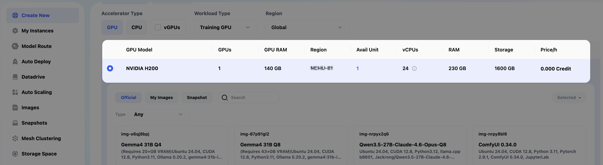
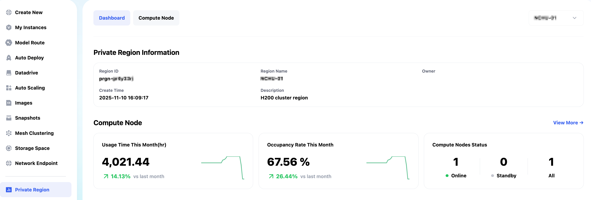
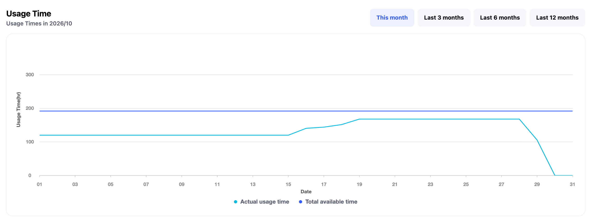
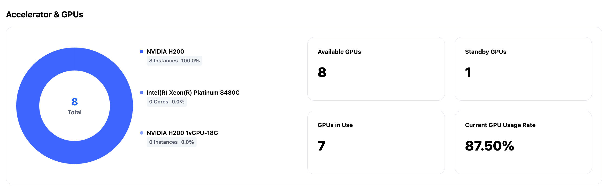
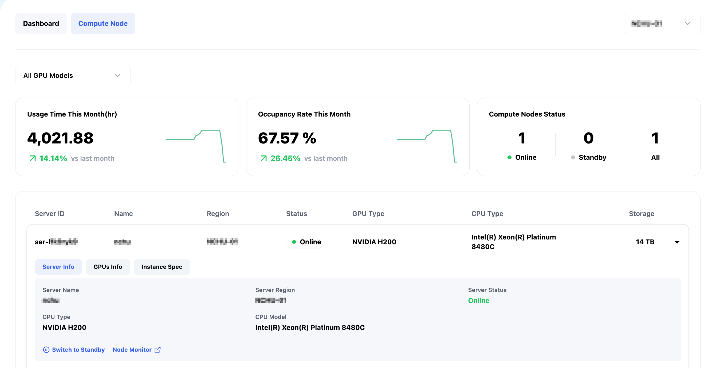
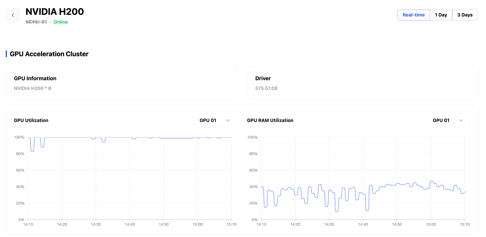

# Private Region 使用教學

Private Region 可以把您本地的 GPU/CPU 機器部署連接到雲端，讓您在任何地方都可以直接使用您本地的 GPU/CPU 機器，並提供了機器資源監控、使用率統計等功能，協助使用者即時掌握 Region 內的運算、儲存及網路資源狀態，提升基礎設施管理效率。

核心功能：

- Dashboard 儀表板：視覺化呈現運算與儲存節點概況、本月使用時長、資源占用率及 GPU 使用情況。
- Region 管理：支援 Region 篩選，查看 ID、名稱、擁有者、備註及建立時間。
- 運算節點管理：查看伺服器規格、CPU/GPU 資訊、MIG 配置與占用狀態。
- 儲存節點管理：監控儲存容量、使用率、硬碟與 RAID 等資訊。
- 網路視覺化：透過網路拓樸呈現節點連線、IP、公網出口、交換器及即時上下行頻寬狀態。

## 功能開通

目前 Private Region 功能僅通過商務渠道開通，如果您有相關需求，可以[點擊這裡](#聯繫我們)聯繫我們，我們會安排商務同事和您對接需求。

## 功能介紹

### 機器租賃功能

Private Region 部署完成後，您可以在 Glows.ai 平臺租用您的機器，機器價格、配置完全由您制定，同時可以使用Glows.ai 平臺的各種功能，比如 預置的Image、Autodeploy 等功能。

### Dashboard 監控數據

在 Glows.ai Platform 界面點擊進入 `Private Region` 可以看到您機器的一些監控數據，有使用時長和使用率統計，也可以點擊`View More` 進入`Compute Node`查看更多機器數據詳情。

界面下滑，可以查看近本月、三個月、六個月、12個月的機器使用時長走勢圖。

查看您機器的可用資源數據。

### Compute Node監控數據

在 Compute Node 界面可以查看更詳細的機器使用相關數據，比如使用總時長、本月使用率、資源狀態等，點擊具體的資源可以查看機器的一些配置數據。

點擊 `Node Monitor`可以查看機器的GPU、CPU、Disk、RAM、Bandwidth等利用率走勢圖。

透過 Private Region 可以統一化的資源管理與視覺化監控能力，讓運算、儲存與網路資源的管理更加直覺、高效且靈活，協助個人與企業簡化管理流程、提升資源使用效率，打造更具彈性與擴展性的算力基礎架構。

## 聯繫我們

如果您在使用 Glows.ai 的過程中有任何疑問或者建議，歡迎通過郵件、Discord 或者 Line 聯繫我們。

**Email:** [support@glows.ai](mailto:support@glows.ai)

**Discord:** [https://discord.com/invite/glowsai](https://discord.com/invite/glowsai)

**Line:** [https://lin.ee/fHcoDgG](https://lin.ee/fHcoDgG)
