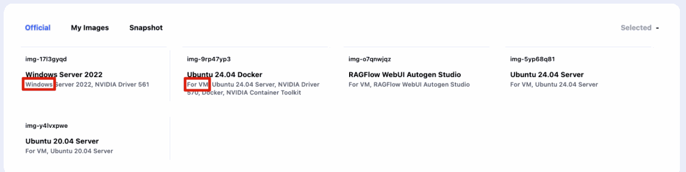
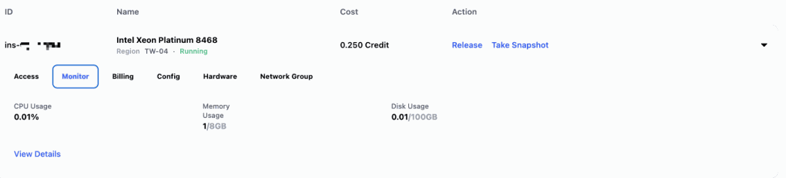
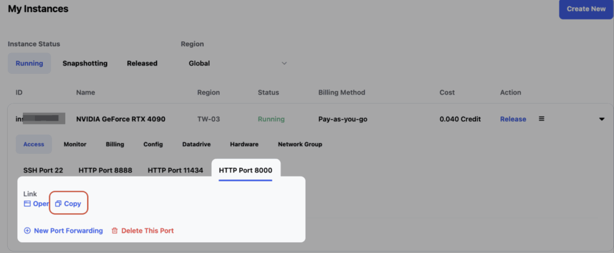
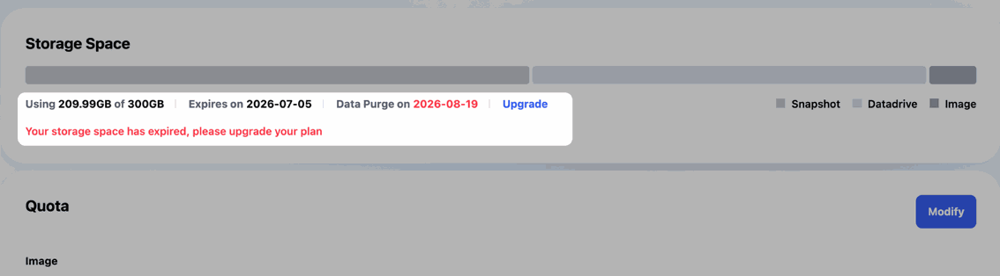
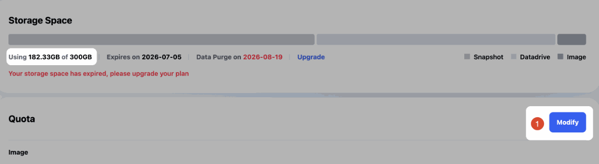
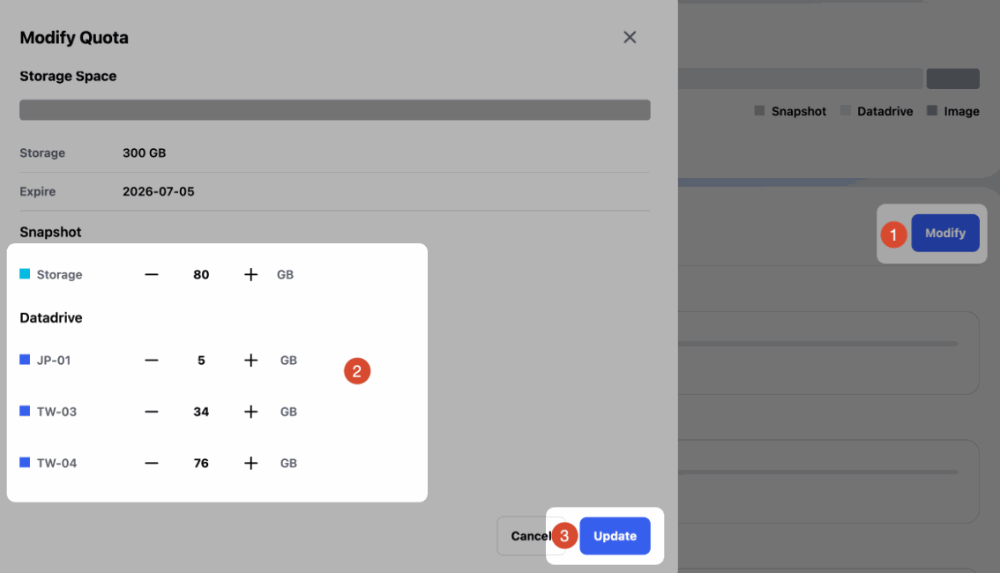
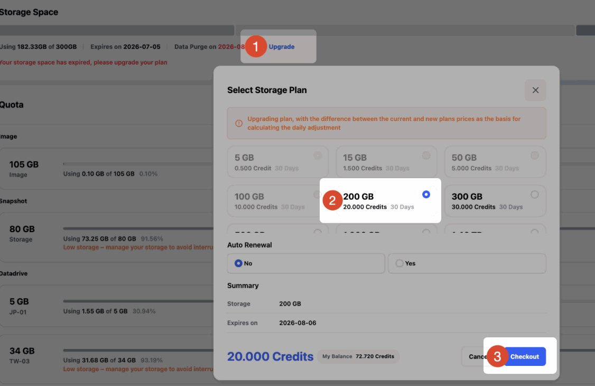

# Glows.ai GPU 租賃平台常見問題

本文整理 Glows.ai GPU 租賃平台的常見問題，涵蓋資料儲存、實例環境、連線方式、自動部署、計費與服務保障等內容。若您需要進一步協助，歡迎透過官方支援管道與我們聯絡。

## 實例類型與權限

### 是否支援 Docker 或 K8s？VM 與 Container 有什麼差異？

Glows.ai 提供 VM 與 Container 兩種底層雲端服務型態。

- Container 實例提供較多預先設定好的基礎環境，環境搭配較簡單，但不支援在實例內自行使用 Docker，也不支援修改 NVIDIA 驅動程式等底層軟體。
- VM 實例具備較高權限，支援自訂 GPU 驅動程式、Docker、Systemctl 等能力，適合需要完整系統控制權的工作負載。

建立實例時選擇 `Windows` 或 `For VM` 類型 Image，即為 VM 實例。



### VM 實例登入後不是 root，執行 docker 等指令時權限不足？

VM 實例預設用 glows 使用者登入。需要 root 權限時，執行：

```bash
sudo su
```

就能切換成 root。密碼就是實例頁 `Access` 裡 glows 使用者的 SSH 密碼。

只想執行單一指令的話，也可以直接在前面加 `sudo`，例如 `sudo docker ps`。

### 是否具備 root 權限？

具備。實例預設使用 root 帳號登入。您也可以登入後自行建立其他使用者。

### 是否支援自選 OS 環境？

目前平台提供 Ubuntu 系列 OS 環境與 Windows Server 2022。一般情境建議優先選擇 Ubuntu。若有其他 OS 需求，可聯絡我們提出需求評估。

### Windows 環境是否可能出現遠端操作卡頓或不穩定？

Windows 在遠端桌面操作下可能受網路、圖形介面與工作負載影響而出現卡頓。若任務不依賴 Windows，建議優先使用 Linux 環境，以取得更穩定的訓練與推論體驗。

### NVIDIA Driver 可以由客戶自行更新嗎？

視實例類型而定：

- Container 類型實例暫不支援自行更換 NVIDIA Driver。
- VM 類型實例可由客戶自行下載並更新 Driver；如有需要，平台可提供技術支援與 NVIDIA 官方下載連結。

### 是否可以即時查看 GPU/CPU 使用率、記憶體與硬碟等資訊？

可以。實例建立後，實例頁面提供 `Monitor` 功能，可查看 CPU/GPU 使用率、GPU 記憶體、系統記憶體、硬碟空間等指標走勢。



## 連線與連接埠

### 支援哪些遠端連線方式？

Ubuntu 實例支援 SSH 與 JupyterLab；Windows 實例支援 RDP。建議優先使用平台提供的連線方式。若需要其他連線工具，可登入實例後自行安裝相關服務。

### RDP 連線網址中的 `tw-02.access.glows.ai` 是否代表實例所在區域？

不一定。連線網址中的 `tw-02` 可能是存取節點代碼，不代表實際運算主機所在區域。請以實例頁面顯示的部署區域為準。

### 為何 SSH 閒置一段時間就自動斷線，出現「closed by remote host」或「Broken pipe」，要怎麼避免？

通常是網路波動或長時間沒操作造成的。實例本身照常運行。

連線時加上 keepalive 設定，讓電腦定期送訊號給伺服器，連線就不會因為太久沒動作被切斷：

```bash
ssh -o ServerAliveInterval=30 -o ServerAliveCountMax=6 -p <port> glows@<host>
```

每 30 秒送一次，連續 6 次（約 3 分鐘）沒有回應才判定斷線。

### 服務在實例裡跑起來了，外面要怎麼連？（例如 8000 port）

1. 服務的 host 要設成 `0.0.0.0`。設成 `localhost` 或 `127.0.0.1` 的話，只有機器自己連得到。
2. 到實例頁按 `New Port Forwarding`，填服務的 port（例如 8000），勾選 HTTPS，就會產生對外網址。

補充：網址裡的 port 不會是 8000，而是像 `:23456` 這樣（如下圖，點擊 `Copy` 後取得的網址不會是 8000）。平台會把機器裡的 port 對應到另一個沒人用的 port，避免大家都用 8000 的衝突。



### 如何讓我的實例啟動時就有對外開放的 port？

用 SDK 建立實例時，在 `ports` 帶上要開的 port，例如：

```json
"ports": "[{\"port\":8000,\"protocol\":2}]"
```

實例 Running 後，平台的 `Access` 分頁也會出現這個 port，查詢實例 API 回傳的 `accesses` 裡也有對應網址（例如：`https://tw-07.access.glows.ai:23456?token=xxxxxxx`）。

注意：機器裡的服務仍是 8000，但對外網址裡的 port 由平台分配，例如 `:23456`。

### 怎樣可以讓我的服務固定網址？

可以使用 Bind IP 並透過 SDK API 開啟機器：在建立實例時帶入 `public_ip_id`，再在 `ports` 裡設定 `exposePort`，指定對外的 port。

例如：

```json
"public_ip_id": "net-xxxxxxxx",
"region_name": "TW-03",
"ports": "[{\"port\":8000,\"protocol\":2,\"exposePort\":18080}]"
```

位址會是「Bind IP:exposePort」，例如 `11.11.11.11:18080`。實例釋放後用同樣設定重建，位址不變。

注意：

- 釋放 Public IP 後再重新建立，URL 會重新分配，所以使用過程中需維持 Public IP 運行。
- 同一個 IP 的同一個 `exposePort` 只能給一台實例使用。

### 實例關機或重啟後 IP/DNS 會變更嗎？

可能會。若需要更穩定的服務入口，建議使用 Auto Deploy 固定服務連結，並由您自行設計流量分配策略。

## DataDrive

### 實例釋放或租期結束後，實例硬碟上的資料會消失嗎？

會。實例硬碟僅在實例運作期間有效，釋放後資料會被清除。

建議將重要資料存放於 DataDrive；如需保留環境或已安裝軟體，請在釋放實例前建立 Snapshot。若不使用平台儲存，也可在釋放前透過 `scp` 等方式下載至本機。

### 是否支援關閉實例後停止運算費用，只保留儲存費用？

支援。當您暫時不需要執行訓練或推論任務時，可以釋放實例（Instance）以停止 GPU 運算資源計費，並透過 DataDrive 與 Snapshot 保留需要的資料或環境。

- 模型、資料集、程式碼等資料型檔案，建議存放於 DataDrive。DataDrive 支援在不啟動實例的情況下上傳與下載資料。
- Python 套件、系統軟體、環境設定等需要下次沿用的內容，建議在釋放實例前按一下 `Take Snapshot` 建立環境快照。
- Snapshot 會保存 DataDrive 以外的實例內部變更。Snapshot 越小，後續從快照建立新實例通常越快。

DataDrive 與 Snapshot 需在 Storage Space 頁面購買儲存方案。您可依實際需求分配 DataDrive 與 Snapshot 的容量。

### 哪裡可以看到已上傳到 DataDrive 的檔案？

建立實例時選擇掛載 DataDrive。登入實例後，即可在 `/datadrive` 目錄查看檔案。

```bash
ls /datadrive
```

### 用 SDK 建立實例時，要怎麼指定掛載 DataDrive？

不需要另外指定。用 SDK 建立的實例會預設掛載 DataDrive，開機後在 `/datadrive` 就能使用。

### 為什麼掛載 DataDrive 之後，要重新設定權限才能讀取？

通常不需要設定權限，因為預設的 glows 使用者本來就有 DataDrive 的讀寫權限，直接讀取即可。

需要另外設定的情況，通常是另外建立了其他使用者，或工具用其他使用者身分執行，例如把 DataDrive 的資料夾連結到 VM 給內部工具讀取。

這種情況可以把使用者、權限和連結都設定好之後做一次 Snapshot，之後用這個快照開機，就不用每次重新設定。

### 多台實例可以共用同一個 DataDrive 嗎？

可以。同一區域內的實例可透過掛載 DataDrive 共用資料。建議在正式任務前先建立測試實例，確認映像檔環境、路徑與權限都符合您的工作流程。

### 已啟動的 VM 可以新增或掛載 DataDrive 嗎？

目前不支援在已啟動的實例上新增掛載 DataDrive。請在建立實例時選擇需要掛載的 DataDrive。

### 已掛載 DataDrive 的實例重開機後，`/datadrive` 目錄消失，資料會遺失嗎？

不會。DataDrive 資料不會因實例重開機而遺失。若重開機後未自動掛載，可在實例內執行以下指令手動掛載：

```bash
sudo mount -t virtiofs DataDrive /datadrive
```

此情況通常是重啟過程中未觸發自動掛載。平台會持續優化相關流程。

### 可以不啟動實例就上傳或下載資料嗎？

可以。DataDrive 支援離線上傳與下載，不需要先啟動 GPU 實例。

- DataDrive 教學影片：[https://www.youtube.com/watch?v=_MtYfNKQ3xA](https://www.youtube.com/watch?v=_MtYfNKQ3xA)
- DataDrive PC 版：[https://glows.ai/datadrive](https://glows.ai/datadrive)

### DataDrive 網頁版可以一次上傳整個資料夾嗎？

目前 DataDrive 網頁版主要支援單一檔案上傳。若需要上傳整個資料夾，建議先壓縮為單一檔案後再上傳，或改用 DataDrive PC 版。

DataDrive PC 版下載連結：[https://glows.ai/datadrive](https://glows.ai/datadrive)

### 在 DataDrive 網頁版上傳大檔失敗怎麼辦？

建議改用 DataDrive PC 版。PC 版支援 Windows 與 macOS，適合上傳或下載大型檔案與資料夾。

下載連結：[https://glows.ai/datadrive](https://glows.ai/datadrive)

### 可以透過指令方式傳輸資料到 DataDrive 嗎？

可以。若您需要以 API 或指令方式操作，可參考 [Glows DataDrive 操作說明](https://hackmd.io/@HulblT-3TB2jIrg2ZPZpyA/glows-dd-api)。此方式較適合具備開發經驗的客戶；一般使用情境建議優先使用 DataDrive 網頁版或 PC 版。

### 如何將本機模型與 Python 程式碼傳入 Glows.ai 實例？

建議優先使用 DataDrive：

1. 將本機檔案上傳至 DataDrive。
2. 建立實例時掛載 DataDrive。
3. 登入實例後在 `/datadrive` 目錄讀取檔案。

若實例已啟動，也可以使用 `scp` 傳輸。以下為 Windows 本機傳輸至實例 `/home` 的範例：

```bash
scp -P 23675 -r C:\Users\Data root@tw-03.access.glows.ai:/home
```

每台實例的 SSH 連線地址與連接埠可能不同，請以實例頁面顯示資訊為準。

### 不同區域的 DataDrive 可以直接同步嗎？

目前不支援跨區 DataDrive 直接同步。若需將資料從 TW-01 移轉至 TW-02，請先下載到本機，再上傳至目標區域的 DataDrive。

### 寫入 DataDrive 時出現 `Disk quota exceeded` 是什麼原因？

此錯誤通常表示儲存空間不足，常見原因包括：

- DataDrive 容量已使用完畢，需清理不需要的檔案，或在 Storage 頁面擴充容量。
- Storage 方案已到期，需續費後才能繼續使用。

### DataDrive 的檔案都刪光了，為什麼還有容量（例如 186 bytes），Storage 配額降不下來？

通常是還有隱藏檔案佔著空間。例如在 Linux 裡刪除檔案時，檔案可能會先被移到隱藏的回收桶資料夾（像 `/datadrive/.Trash-0`），一般的 `ls` 看不到。

1. 開一台掛載這個 DataDrive 的實例（最便宜的 CPU 機器就可以），執行 `ls -alh /datadrive` 查看隱藏檔案。
2. 確認是不需要的檔案後再刪除，例如 `rm -rf /datadrive/.Trash-0`。
3. 回到 Storage Space 重新調整配額。

### DataDrive 已清空，為什麼 Storage 頁面仍顯示有容量被使用？

透過 DataDrive 介面刪除資料後，Storage 頁面通常需要 5-10 分鐘同步狀態。若需確認實際使用量，可建立同區域實例並掛載 DataDrive，然後執行：

```bash
# 查看總儲存使用量
df -h

# 查看 /datadrive 下各檔案與資料夾
ls -alh /datadrive
```

Ubuntu 檔案系統可能會將部分刪除的檔案暫存至 `/datadrive/.Trash-0`。若確認不再需要，可執行以下指令永久刪除：

```bash
# 此操作無法復原，請確認路徑後再執行
rm -rf /datadrive/.Trash-0
```

## Snapshot

### Glows.ai 的快照功能會保留已安裝程式與資料嗎？

會。Snapshot 會保存建立快照當下實例內的檔案、設定、已安裝軟體與組態內容，但不包含 DataDrive 內的資料。

### 如何更有效率地使用 Snapshot？

Snapshot 會保存實例硬碟上的變更。建議將環境、套件與系統設定保留在實例硬碟，將資料集、模型權重與程式碼放在 DataDrive。這樣可以降低 Snapshot 大小，並提升後續從快照建立新實例的速度。

跨區使用 Snapshot 時，建立新實例的速度會受 Snapshot 大小與網路傳輸狀況影響，因此建議保持 Snapshot 精簡。

### Snapshot 可以匯出嗎？

不支援。Snapshot 為 Glows.ai 平台內部使用的快照格式，目前不支援直接匯出。

### 用快照開機後，之前設的 Port Forwarding 還在嗎？網址會變嗎？

不在，網址也會變。

Port Forwarding 是平台分配的對外通道（從外部連進這台機器的通道），設定在平台上，而不是在機器裡，所以每次用快照開機都要重新點擊 `New Port Forwarding` 設定。至於機器裡面的服務本身（是否運行、監聽哪個 port），這些都存在硬碟裡，快照會保存。

### 之前存的 Snapshot 有 VNC，再次開啟後就沒有 VNC 了？（用 Snapshot 建立實例後看不到 VNC port 連結）

可以先確認 VNC 服務有沒有在跑，再看平台上有沒有開對應的 port。

1. 登入 SSH 後，確認 VNC 服務有沒有正常啟動：執行 `ss -napt | grep 5901` 或 `ps aux | grep vnc`，查看連接埠監聽與程序執行狀況。
2. 如果 VNC 服務正常，可以到平台上點擊 `New Port Forwarding`，設定 VNC 服務對應的 port（即 VNC 服務在機器裡監聽的 port，常見為 5901）。
3. 如果 VNC 沒有在跑，先把 VNC 服務啟動；映像沒有預裝 VNC 的話（例如 Ubuntu 映像），需要先自行安裝。

### 用快照開機後，服務沒有自動啟動？要怎麼設定開機自動啟動？

要依實例類型設定：

- **Container**：可以把服務的啟動指令加進 `/usr/bin/glows_init.sh`。
- **VM**：用 systemd 設定開機自動啟動，可以參考教學文件（以開機自動啟動 Docker 容器為例）：[如何在 Glows.ai 上設定 Ubuntu 開機自動重啟 Docker 容器](https://glows.ai/zh-TW/article/ubuntu_docker_restart_boot)

## Storage 方案

### DataDrive 與 Snapshot 會在儲存方案到期後自動刪除嗎？

不會立即自動刪除。DataDrive 與 Snapshot 採儲存方案管理；方案到期後，資料會保留一段可恢復狀態，但需續費後才能繼續正常使用。為避免影響任務，建議在方案到期前完成續費。

### Storage 續費時如何降級方案？

若希望從較高容量方案降級至較低容量方案，需先確保目前實際使用量低於目標方案容量。

例如原方案為 300GB，若要續費為 200GB，需先將實際使用量清理至 200GB 以下。可刪除 DataDrive、Snapshot 或 Images 中不再需要的檔案。



清理後確認使用量已低於目標方案容量。



按一下 `Modify`，將已分配總額度調整至小於或等於目標方案容量，然後按一下 `Update`。



完成後按一下 `Upgrade`，即可選擇較低容量方案。



### 如果更新 Storage Space 方案大小，正在運行中的實例需要重新掛載 DataDrive 才能套用新的大小嗎？

無需重新掛載，資料是即時同步的，可以隨時擴容。

### 儲存空間如何計價？

儲存空間採方案或用量方式計費，具體價格請以平台 Storage 頁面顯示為準。大量採購或企業需求可聯絡我們洽談。

## 自訂映像檔

### 如何上傳自訂 Docker 映像檔？

請參考官方教學：[上傳自訂 Docker 映像檔](/docs/upload-custom-docker-image)

### Image 檔案過大，網路不穩或切換頁面導致上傳中斷怎麼辦？

平台支援斷點續傳。即使上傳過程中斷，也可以從中斷位置繼續上傳，不需要重新開始。

### 檔名後綴 `.partial` 是什麼意思？

`.partial` 是系統在檔案上傳期間產生的暫存檔。上傳完成後會自動消失，不影響正常使用。

## Auto Deploy 與 API 自動化

### 是否支援自動擴縮？

支援。平台提供 Auto Deploy 功能，可在收到請求時自動建立實例、啟動服務，並在閒置後釋放實例。

典型流程如下：

1. 客戶請求 Auto Deploy 連結。
2. Glows.ai 後端依設定建立實例。
3. 執行您設定的 Service Start Command。
4. 將請求轉發至您設定的服務連接埠。
5. 回傳處理結果。
6. 若超過您設定的閒置時間（Instance Idle Retention Period）沒有新的請求，平台會自動釋放實例。

若有併發需求，建議使用自有流量分配策略搭配多個 Auto Deploy 設定。

### 是否提供 CLI 或 API 自動部署？

- **API**：有。Glows.ai 提供 SDK HTTP API，可以用程式建立、查詢、釋放實例，也能設定 port、網路與 Snapshot。SDK Token 可自行建立：開啟 [https://platform.glows.ai/profile](https://platform.glows.ai/profile) → `Platform Setting` → `SDK Token` → `New Token`。API 文件：[https://sdkdoc.glows.ai](https://sdkdoc.glows.ai)
- **Auto Deploy**：目前透過網頁設定，SDK API 沒有 Auto Deploy 的功能。需要用程式控制開關機時，可改用 SDK API 直接操作實例。

### 是否可透過 API 開關機器以避免閒置費用？

可以。用 SDK API 建立實例（`POST /instance`），不用時釋放（`DELETE /instance`）。

## 網路與企業方案

### 平台是否販售網路流量？是否提供固定頻寬或固定 IP？

一般情況下，平台不另外收取資料傳輸費。固定 IP（Bind IP）可直接在平台上購買。若需要固定 1Gbps 頻寬等進階網路能力，可申請加購，由業務與技術團隊確認需求後啟用。

### 是否可使用企業私有網段或 VPN 限定存取？

可以。平台已提供 IP ACL 功能，可設定允許存取實例的 IP，例如只允許公司 VPN 網段連線。

### 既有伺服器或 GPU 機器可以整合進 Glows.ai 嗎？

可透過混合雲或私有雲方案進行專案評估，將本地 CPU/GPU 機器整合為運算資源池的一部分。具體可行性需由技術團隊根據硬體、網路與部署需求確認。

如有需求，請[聯繫我們](#聯繫我們)。

### 私有雲是否支援 CPU 機器加入並統一管理？

支援。私有雲方案可依需求整合本地非 GPU 機器，並提供統一管理與調度能力。具體方案需經專案評估。

## GPU 資源

### H100/H200 GPU 是否支援 NVIDIA MIG 切分？

Glows.ai 平台部署的 H100/H200 GPU 支援 NVIDIA MIG 能力。具體開放方式與設定需依產品方案與實際資源情況確認。

### GPU 是否都是整片租賃？

目前平台主要提供整片 GPU 租賃。

### GPU 之間是否支援 NCCL 通訊？

支援。NCCL 可用於分散式訓練與多 GPU 資料同步。

### vGPU 功能是否有上線計畫？

vGPU 目前尚未公布正式上線時間。若您有部分 GPU 記憶體、成本控制或虛擬化 GPU 相關需求，可彙整使用情境並提供給我們評估。

## 應用程式（ComfyUI、FramePack）

### 使用 FramePack 等工具產生影片後無法下載，該怎麼處理？

請先確認實例尚未釋放，然後嘗試透過 JupyterLab 手動下載：

1. 進入該實例的 JupyterLab。
2. 前往 `/FramePack/outputs/`。
3. 找到產生的 `.mp4` 檔案。
4. 在檔案上按一下右鍵，選擇 `Download`。

若仍無法下載，請截圖並聯絡平台技術支援。

### ComfyUI 匯入工作流程後缺少自訂節點，如何處理？

請先建立實例並載入工作流程，然後提供錯誤畫面或缺少節點的提示。平台技術支援可協助確認需要安裝的自訂節點或相依套件。

### ComfyUI 測試 WAN 2.1 時提示缺少 Model，代表什麼？

通常表示模型尚未正確載入。請確認模型檔案位置、工作流程設定與模型名稱是否正確；如仍無法解決，請提供錯誤截圖供技術支援分析。

## 帳號、計費與儲值

### 是否可以使用一般 Email 註冊，而不是 Gmail？

目前系統預設支援 Gmail 和 GitHub 註冊。若您需要使用一般 Email 建立帳號，請聯絡技術或業務團隊協助評估與處理。

### 線上儲值是否有最低金額？

有。平台線上儲值最低金額為 10 美元，並以 10 美元為遞增單位。

### 忘記儲值導致點數耗盡怎麼辦？

點數耗盡後，系統會自動為執行中的實例建立快照並關閉實例。重新儲值後，您可從自動產生的快照恢復環境。

### 是否有最低租用時數？

沒有。平台採用 pay-as-you-go 計費模式，用多少付多少。實例未運作時不產生 GPU 運算費用，僅依實際使用情況收取儲存費用。

### H100 GPU 價格是多少？

H100 GPU 隨用隨付價格請以平台頁面顯示為準。長期租用或包月需求可聯絡我們洽談優惠方案。

### 是否有大量或長期租用優惠？

有。大量或長期租用可透過以下方式聯絡我們：

- **Email:** [support@glows.ai](mailto:support@glows.ai)
- **Discord:** [https://discord.com/invite/glowsai](https://discord.com/invite/glowsai)
- **Line:** [https://lin.ee/fHcoDgG](https://lin.ee/fHcoDgG)

### 使用前是否需要支付訂閱費、設定費或最低使用費？

不需要。一般使用情境無訂閱費、設定費或最低使用費。

### 軟體或平台合作客戶如何計價？

可依使用量、儲存量與合作模式評估計費方案。若涉及代理、轉售或平台合作，可聯絡業務團隊洽談合作協議。

## 服務保障與補償

### 是否提供 SLA？

提供。平台目前主要針對硬體與儲存服務提供服務水準承諾：

- 核心硬體服務：99% 可用性。
- DataDrive 儲存服務：99.9% 可用性。

具體條款以正式服務協議為準。

### 若服務中斷，是否有備援與補償政策？

若因硬體或平台原因導致租用的實例不可用，我們會儘快核查故障時間與原因，優先恢復服務與資料，並依情況提供補償。

基礎補償參考：

- 故障 1-3 小時：補償 6 小時。
- 故障 6-12 小時：補償 12 小時。

若故障造成資料遺失、任務中斷且無法恢復等重大影響，平台會依具體情況進一步評估。除物理硬碟故障等特殊情況外，正常已存資料通常不會遺失。重要資料建議優先存放於 DataDrive。

## 聯繫我們

如果您在使用 Glows.ai 的過程中有任何疑問或者建議，歡迎通過郵件、Discord 或者 Line 聯繫我們。

**Email:** [support@glows.ai](mailto:support@glows.ai)

**Discord:** [https://discord.com/invite/glowsai](https://discord.com/invite/glowsai)

**Line:** [https://lin.ee/fHcoDgG](https://lin.ee/fHcoDgG)
